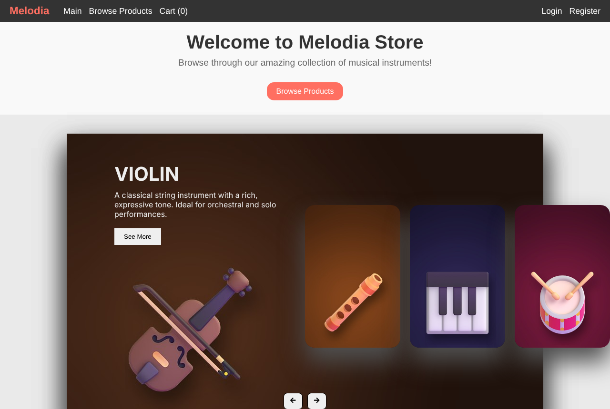
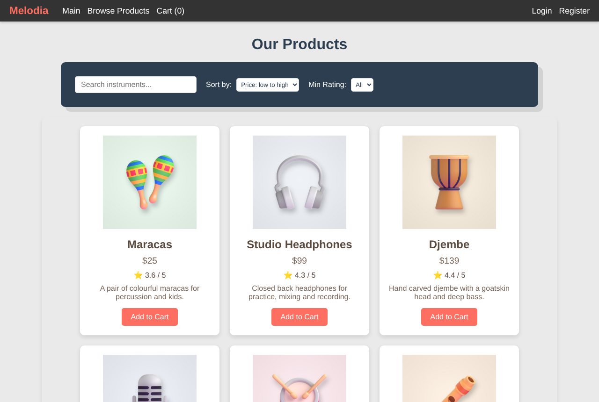
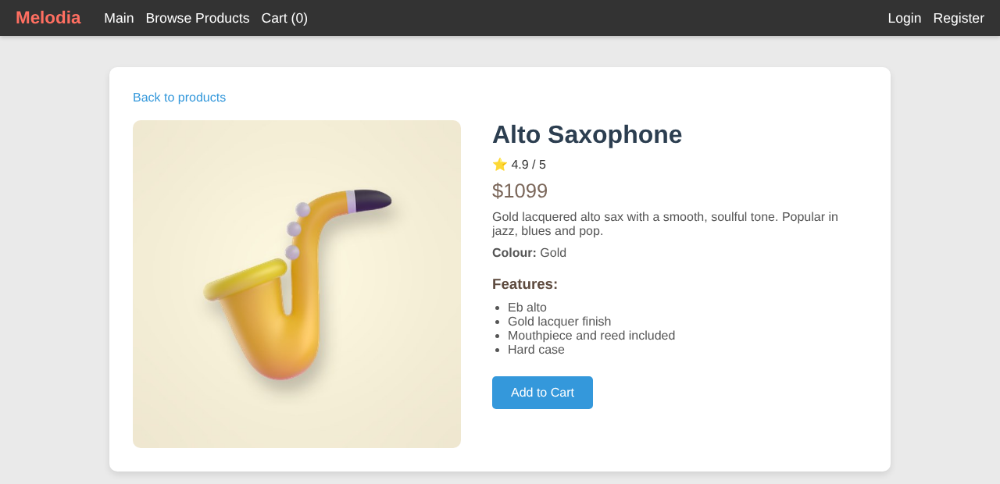
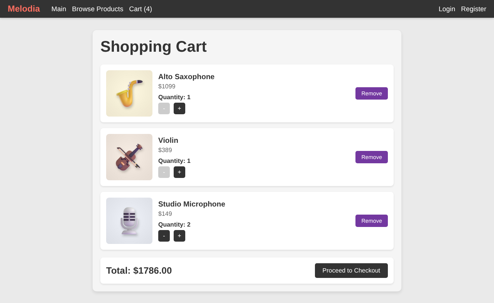
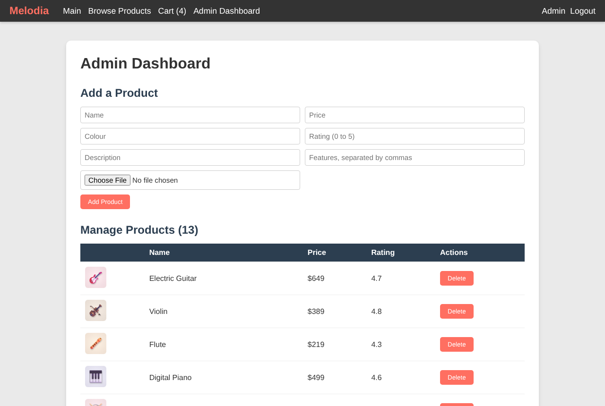

# Melodia Store

Melodia Store is an online shop for musical instruments built with the MERN stack: MongoDB, Express, React and Node.js. You can browse and search the instruments, add them to a cart and pay with PayPal, and an admin can manage the products and the users.

I made it with [violetdestiny](https://github.com/violetdestiny) as a college project in second year at DkIT, between December 2024 and March 2025. In November 2026 I went back to it and finished the parts that were missing.




## What the app does

The home page has a slider with some of the instruments, and each one links to its product page. On the products page you can search by name, sort by price or rating and filter by minimum rating. Each product has its own page with the description, colour and features.

The cart keeps the quantity of each product and is saved in the browser, so it is still there after a refresh. To pay you need to be logged in, and the payment is done with the PayPal buttons in sandbox mode. When PayPal confirms the payment, the order is saved in MongoDB and shows up on your profile page.

To register you need a name, an email and a password with at least 8 characters, an uppercase letter, a lowercase letter and a number. You can also add a profile picture, and change it later from your profile.

The admin can add products with an image, delete products and see and delete customers. The admin account is created the first time the server starts.





## How it's built

The server is Express with Mongoose and has three groups of routes: products, users and orders. Passwords are hashed with bcryptjs and login returns a JWT signed with RS256. The private key is created the first time the server runs and is not in the repo. Routes that need a user go through authMiddleware, which checks the token, and the admin routes also go through roleMiddleware, which checks the access level. The register and add product forms are checked with express-validator, and the images are uploaded with multer.

When an order is saved, the server only takes the product ids and quantities from the client and works out the prices and the total from the database, so the total can't be changed from the browser.

The client is a React app with React Router. App.js keeps the cart and the logged in user in its state and in localStorage, and passes them to the pages. The pages use axios to call the server, and the styles are written in SCSS.

The instrument pictures are from Microsoft's [Fluent Emoji](https://github.com/microsoft/fluentui-emoji) (MIT licence).

## How to run it

You need Node.js 18 or newer and MongoDB running on your machine on the default port.

Start the server:

```
git clone https://github.com/hypzx2105/eCommers.git
cd eCommers
npm install
cp server/config/.env.example server/config/.env
npm run seed
npm start
```

`npm run seed` adds 13 instruments to the database. Then start the client in a second terminal:

```
cd client
npm install
npm start
```

The shop opens on http://localhost:3000 and the server runs on port 4000. The admin login is admin@ecommerce.com with the password AdminPass123!, and you can change both in the .env file before the first start. To try a payment you need a PayPal sandbox buyer account.

Iker Arza, DkIT, BSc in Computing in Software Development
